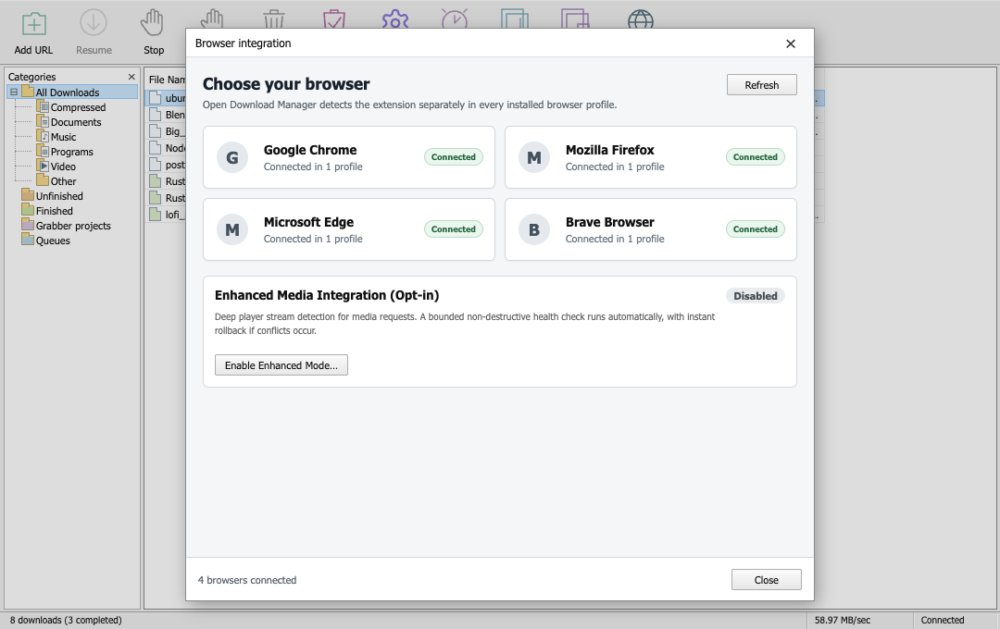

# Browser installation

Browser packaging and native-host registration are paused during the Tauri
migration. The current checkout does not contain the previous Electron
packaging scripts. See commit `302fc1c` for the tracked pre-migration source;
do not use the historical workflow as evidence of Tauri compatibility.

The current preview automatically connects an extension after it is installed.
It does not yet install the extension in a new browser.

Browser Integration reports each browser separately. The state comes from real
native messaging traffic, not from reading browser profile folders (macOS
denies access to the Chrome and Edge profile folders, so a profile probe would
always report "not detected"):

| State | Meaning |
| :--- | :--- |
| **Connected** | The extension answered recently. The toolbar badge is gone. |
| **Setup needed** | The browser is installed, but the extension never answered. |
| **Disconnected** | The extension answered before and the browser is running but silent — it was removed or disabled. |
| **Not installed** | No executable for that browser on this computer. |

The extension is delivered to `Downloads/Open Download Manager Extension/` by
the **Download extension** button. A browser cannot load an extension from
inside an application bundle, so the app copies it to a normal folder the user
can pick in the browser's "Load unpacked" dialog.

For consumer Windows Chrome, external installation requires a published Chrome
Web Store extension. The desktop installer can register its store update URL;
Chrome then downloads the extension and asks the user to enable it. It cannot
silently enable a bundled unpacked extension. Edge supports external installation
from its own store or the Chrome Web Store.

Firefox 74 and newer does not allow an ordinary desktop application to silently
install its companion add-on. The supported Firefox option currently uses a temporary
flow; permanent distribution requires a signed XPI or an AMO listing.

## Prepare the submission

Resume this work after the Rust native-messaging host and Tauri packaging are
implemented and tested. Revalidate the extension package, permissions,
privacy disclosures, native messaging allowlist, and install/uninstall
registration against the migrated app before submitting it to a store.

Official distribution references:

- https://developer.chrome.com/docs/extensions/how-to/distribute/install-extensions
- https://learn.microsoft.com/en-us/microsoft-edge/extensions/developer-guide/alternate-distribution-options
