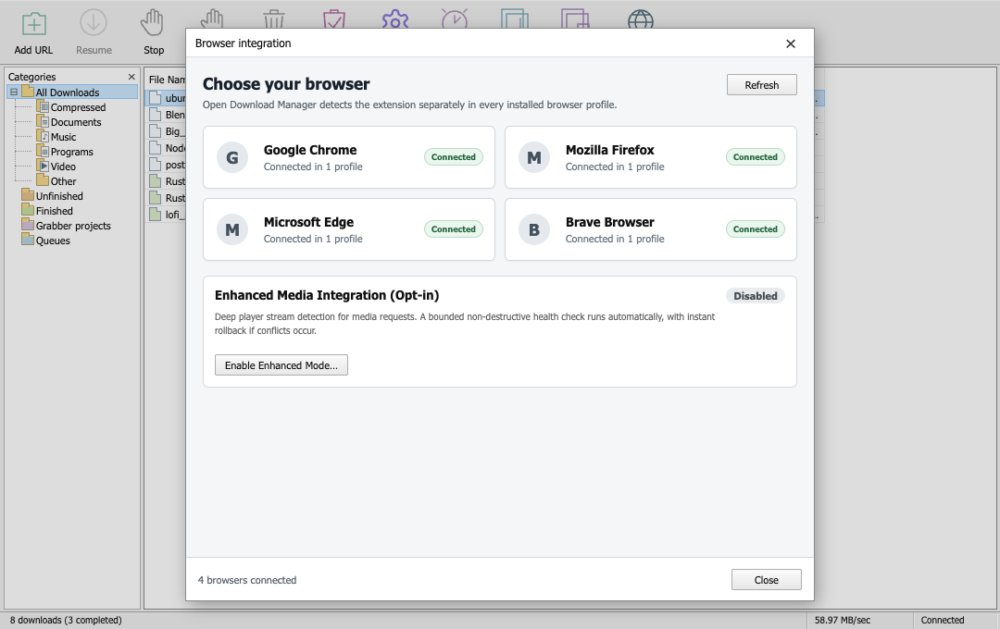

# Installation and Setup Guide

Open Download Manager is available across macOS, Windows, and Linux, with native browser integration extensions for Chromium-based browsers and Firefox.

---

## 1. Desktop Application Installation

### macOS (Apple Silicon & Intel)
1. Download the latest `.dmg` installer from the [Releases page](https://github.com/devenvoy/open-download-manager/releases/latest):
   - **Apple Silicon (M1/M2/M3/M4)**: `open-download-manager_0.3.0-beta.1_mac_arm64.dmg`
   - **Intel x86_64**: `open-download-manager_0.3.0-beta.1_mac_x64.dmg`
2. Double-click the downloaded `.dmg` file.
3. Drag **Open Download Manager** into your **Applications** folder.
4. Launch Open Download Manager from Applications or Spotlight.

### Windows (10 / 11)
1. Download the setup executable from the [Releases page](https://github.com/devenvoy/open-download-manager/releases/latest):
   - **Windows 64-bit (x64)**: `open-download-manager_0.3.0-beta.1_win_x64-setup.exe`
   - **Windows ARM64**: `open-download-manager_0.3.0-beta.1_win_arm64-setup.exe`
2. Run the installer wizard and complete the setup.
3. Launch Open Download Manager from the Start Menu or desktop shortcut.

### Linux (Ubuntu, Debian, Fedora, Arch)
1. Download the package for your distribution from the [Releases page](https://github.com/devenvoy/open-download-manager/releases/latest):
   - **Debian / Ubuntu / Mint**: `open-download-manager_0.3.0-beta.1_lin_x64.deb`
     ```bash
     sudo dpkg -i open-download-manager_0.3.0-beta.1_lin_x64.deb
     sudo apt-get install -f # resolve any missing dependencies if needed
     ```
   - **Universal Linux AppImage**: `open-download-manager_0.3.0-beta.1_lin_x64.AppImage`
     ```bash
     chmod +x open-download-manager_0.3.0-beta.1_lin_x64.AppImage
     ./open-download-manager_0.3.0-beta.1_lin_x64.AppImage
     ```

---

## First launch (unsigned beta)

The beta builds are not signed with an Apple Developer ID or a Windows code
signing certificate yet, so the operating system checks them:

- **macOS**: "Open Download Manager" cannot be opened because the developer
  cannot be verified. Open **System Settings → Privacy & Security**, scroll to
  the blocked section and click **Open Anyway**. On older macOS versions use
  right-click → **Open** instead of double-clicking the app.
- **Windows**: "Windows protected your PC". Click **More info** →
  **Run anyway**.

Both prompts disappear as soon as the release is signed and notarized.

---

## 2. Browser Extension Setup

Open Download Manager communicates seamlessly with your browser using the Native Messaging protocol.

The desktop app ships the browser extension and saves it into your **Downloads**
folder, so the setup never depends on a hidden file or a temporary download.

### Chromium Browsers (Google Chrome, Microsoft Edge, Brave, Opera, Vivaldi)
1. Open Open Download Manager and click **Browser Integration** in the toolbar.
2. Select your browser and click **Download extension**. The extension is saved to
   `Downloads/Open Download Manager Extension/extension` and the folder opens in
   your file manager.
3. Open your browser's extensions manager:
   - Chrome: `chrome://extensions`
   - Edge: `edge://extensions`
   - Brave: `brave://extensions`
   - Opera: `opera://extensions`
4. Toggle on **Developer mode** in the top-right corner.
5. Click **Load unpacked** and select the folder
   `Downloads/Open Download Manager Extension/extension` (the one containing
   `manifest.json`).
6. Return to Open Download Manager and click **Refresh**. The browser shows as
   **Connected** as soon as the extension answers, and the toolbar badge
   disappears.

<p align="center">
  
</p>

### Mozilla Firefox
1. Open Open Download Manager, click **Browser Integration**, select Firefox and
   click **Download extension**. The extension is saved to
   `Downloads/Open Download Manager Extension/extension-firefox`.
2. In Firefox open `about:debugging#/runtime/this-firefox`.
3. Click **Load Temporary Add-on** and select `manifest.json` inside that folder.
4. Return to Open Download Manager and click **Refresh**. The browser shows as
   **Connected**.

### Installing the packaged extension instead
`open-download-manager_0.3.0-beta.1_ext_chrome.zip` and
`open-download-manager_0.3.0-beta.1_ext_firefox.xpi` from the
[Releases page](https://github.com/devenvoy/open-download-manager/releases/latest)
carry the same extension. Unzip the archive into a permanent folder (e.g.,
`Documents/OpenDownloadManagerExtension`) and load it from there.

---

## 3. Media Tools Integration (`yt-dlp` & `ffmpeg`)

For downloading and merging adaptive YouTube streams (SABR / 1080p+ videoplayback):
1. In Open Download Manager, navigate to **Options → Media Tools**.
2. If `yt-dlp` or `ffmpeg` is already in your system PATH, the app will auto-detect it.
3. If not installed, click **Install Media Tools** to automatically download official, verified binaries to your local directory (`~/.open-download-manager/tools/`).
