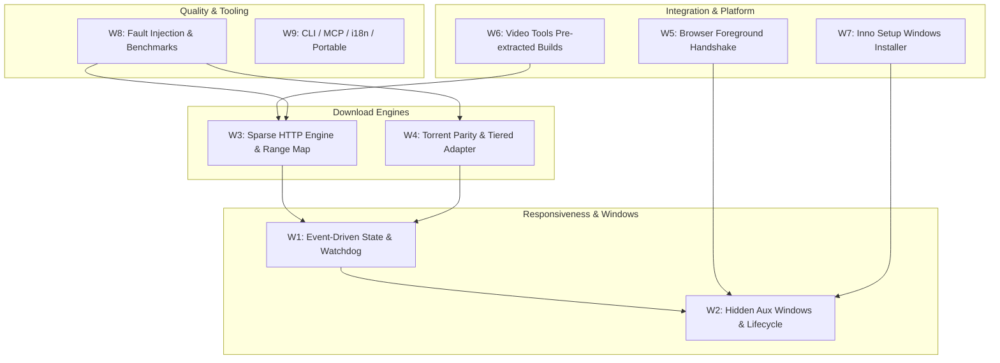
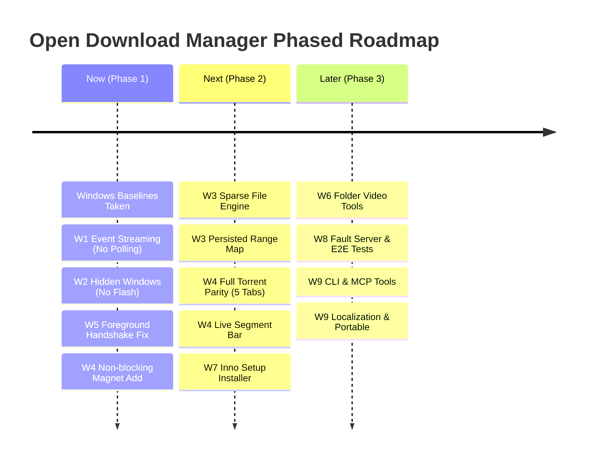

# Open Download Manager: Architecture, Engine & Parity Update Plan

**Target Document**: `docs/audit/update-plan.md`  
**Date**: November 16, 2026  
**Auditor/Planner**: Antigravity (Google DeepMind Agent)  
**Workspace**: `/Users/devanshpc/Developer/open-download-manager`  
**Stack**: Tauri v2 + Clean Architecture Rust Backend + React 19 / TypeScript / Vite / Tailwind v4  
**Reference Target**: [anefzaoui/misterdownloadmanager](https://github.com/anefzaoui/misterdownloadmanager) (`reference/misterdownloadmanager`)  
**License Boundary**: MDM is **GPL-3.0-or-later**; Open Download Manager is **MIT**. Clean-room design only; zero code, text, or asset copying.  

---

## Table of Contents
- [Section 0: Baseline Measurements to Take FIRST on Windows](#section-0-baseline-measurements-to-take-first-on-windows)
- [Section 1: Corrected Findings Table (Audit Hypothesis vs. Reality)](#section-1-corrected-findings-table)
- [Section 2: Workstreams & Technical Specifications](#section-2-workstreams--technical-specifications)
  - [W1: Responsiveness & Threading Model](#w1-responsiveness--threading-model)
  - [W2: Windows & Startup Lifecycle](#w2-windows--startup-lifecycle)
  - [W3: High-Performance HTTP/FTP Download Engine](#w3-high-performance-httpftp-download-engine)
  - [W4: BitTorrent & Download Window Parity](#w4-bittorrent--download-window-parity)
  - [W5: Browser Integration & Native Messaging](#w5-browser-integration--native-messaging)
  - [W6: Media Tools & Stream Processing](#w6-media-tools--stream-processing)
  - [W7: Packaging, Installer & Release Automation](#w7-packaging-installer--release-automation)
  - [W8: Test Infrastructure & Fault Injection](#w8-test-infrastructure--fault-injection)
  - [W9: Later & Optional Enhancements](#w9-later--optional-enhancements)
- [Section 3: Phased Roadmap with Gate Budgets (Now / Next / Later)](#section-3-phased-roadmap-with-gate-budgets)
- [Section 4: Compatibility, Schema Versioning & Session Lifecycle](#section-4-compatibility-schema-versioning--session-lifecycle)
- [Section 5: Architectural Risks & Anti-Patterns (Things NOT to Do)](#section-5-architectural-risks--anti-patterns)
- [Section 6: Decisions Needed & Clarification Questions](#section-6-decisions-needed--clarification-questions)
- [Section 7: Master Action Plan (Top 10 Changes & Week 1 Priorities)](#section-7-master-action-plan)

---

## Section 0: Baseline Measurements to Take FIRST on Windows

> [!IMPORTANT]
> The development and auditing agent environment is running on macOS (`Darwin ARM64`). All Windows-dependent baseline numbers in this audit are tagged `[NEEDS-WINDOWS-DATA]` until executed on a physical Windows host or GitHub Actions `windows-latest` runner. Never commit unmeasured estimates as benchmark truths.

### 0.1 Windows Test Protocol & PowerShell Execution Script

> [!TIP]
> **Safety & Execution Rules**:
> - **Non-Admin Execution**: Run this script in a standard, non-elevated PowerShell prompt.
> - **Zero Side-Effects**: Contains **zero** registry writes and **no** `Remove-Item` calls outside `$env:TEMP\odm-bench-*`.
> - **Installed Release Build**: Benchmarks the installed GitHub release binary (`open-download-manager.exe`), testing the genuine production bundle with Windows Defender active.
> - **Protocol**: Close other background applications, run the script **3 times**, and paste back the complete output along with your Windows version, drive type (SSD/HDD), and Defender status.

```powershell
# Save as: tools/dev/benchmark-windows-baseline.ps1
# Run from normal PowerShell: powershell -ExecutionPolicy Bypass -File tools/dev/benchmark-windows-baseline.ps1

Write-Host "==========================================================" -ForegroundColor Cyan
Write-Host "  Open Download Manager: Windows Production Baseline Run  " -ForegroundColor Cyan
Write-Host "==========================================================" -ForegroundColor Cyan

# 1. System Environment Diagnostics (Read-Only)
$os = Get-CimInstance Win32_OperatingSystem
$cpuInfo = Get-CimInstance Win32_Processor
$disk = Get-PhysicalDisk | Select-Object -First 1
$defender = Get-MpComputerStatus -ErrorAction SilentlyContinue

Write-Host "`n[System Environment]" -ForegroundColor Yellow
Write-Host "OS Version      : $($os.Caption) ($($os.Version), Build $($os.BuildNumber))"
Write-Host "Processor       : $($cpuInfo.Name) ($([Environment]::ProcessorCount) logical cores)"
Write-Host "Drive Type      : $($disk.MediaType) ($($disk.BusType))"
Write-Host "Defender Active : $(if ($defender.RealTimeProtectionEnabled) { 'YES (Real-Time Protection ON)' } else { 'OFF/Third-Party' })"

# 2. Locate Production Release Executable
$possiblePaths = @(
    "$env:LOCALAPPDATA\Programs\Open Download Manager\open-download-manager.exe",
    "$env:ProgramFiles\Open Download Manager\open-download-manager.exe",
    ".\target\release\open-download-manager.exe"
)

$appPath = $null
foreach ($path in $possiblePaths) {
    if (Test-Path $path) {
        $appPath = (Resolve-Path $path).Path
        break
    }
}

if (-not $appPath) {
    Write-Host "`nInstalled Open Download Manager not found in standard paths." -ForegroundColor Red
    $appPath = Read-Host "Please enter the full path to open-download-manager.exe"
}

if (-not (Test-Path $appPath)) {
    Write-Error "Executable not found at '$appPath'. Aborting benchmark."
    exit 1
}

$appVersion = (Get-Item $appPath).VersionInfo.FileVersion
Write-Host "Testing Binary  : $appPath (v$appVersion)" -ForegroundColor Green

# 3. Cold Start Timeline (5 consecutive iterations)
Write-Host "`n[Benchmark 1/3] Measuring Cold-Start Latency (Process Spawn -> Input Idle)..." -ForegroundColor Yellow
$coldSamples = @()
for ($i = 1; $i -le 5; $i++) {
    $sw = [System.Diagnostics.Stopwatch]::StartNew()
    $proc = Start-Process -FilePath $appPath -ArgumentList "--background" -PassThru
    $proc.WaitForInputIdle(5000) | Out-Null
    $sw.Stop()
    $elapsed = $sw.ElapsedMilliseconds
    $coldSamples += $elapsed
    Write-Host "  Iteration $i : $elapsed ms"
    Stop-Process -Id $proc.Id -Force
    Start-Sleep -Milliseconds 400
}

$coldAvg = [Math]::Round(($coldSamples | Measure-Object -Average).Average, 1)
$coldMin = ($coldSamples | Measure-Object -Minimum).Minimum
$coldMax = ($coldSamples | Measure-Object -Maximum).Maximum
Write-Host "-> Cold-Start Summary: Min = $coldMin ms | Avg = $coldAvg ms | Max = $coldMax ms" -ForegroundColor Green

# 4. Measure Idle CPU & Memory Footprint (Active UI window over 45 seconds)
Write-Host "`n[Benchmark 2/3] Measuring Idle CPU & Memory (45-second sampling)..." -ForegroundColor Yellow
$proc = Start-Process -FilePath $appPath -PassThru
Start-Sleep -Seconds 4 # Allow WebView2 runtime and React to mount

$cpuSamples = @()
$wsSamples = @()
for ($s = 1; $s -le 9; $s++) {
    Start-Sleep -Seconds 5
    $proc.Refresh()
    if ($proc.HasExited) { break }
    
    # Query performance counter for exact process CPU utilization
    $counter = (Get-Counter "\Process(open-download-manager*)\% Processor Time" -ErrorAction SilentlyContinue).CounterSamples | Measure-Object -Property CookedValue -Sum
    if ($counter -and $counter.Sum -ne $null) {
        $normalizedCpu = [Math]::Round(($counter.Sum / [Environment]::ProcessorCount), 2)
        $cpuSamples += $normalizedCpu
    }
    $ramMB = [Math]::Round(($proc.WorkingSet64 / 1MB), 1)
    $wsSamples += $ramMB
    Write-Host "  Sample $s (+$($s * 5)s): CPU = $normalizedCpu% | WorkingSet = $ramMB MB"
}
Stop-Process -Id $proc.Id -Force

$avgCpu = if ($cpuSamples.Count -gt 0) { [Math]::Round(($cpuSamples | Measure-Object -Average).Average, 2) } else { 0.0 }
$avgRam = if ($wsSamples.Count -gt 0) { [Math]::Round(($wsSamples | Measure-Object -Average).Average, 1) } else { 0.0 }
Write-Host "-> Idle Load Summary: Avg Normalized CPU = $avgCpu% | Avg Memory = $avgRam MB" -ForegroundColor Green

# 5. Snapshot Serialization Benchmark (if perf_benchmark.exe is present)
$benchTool = Join-Path (Split-Path $appPath) "perf_benchmark.exe"
if (-not (Test-Path $benchTool)) {
    $benchTool = ".\target\release\perf_benchmark.exe"
}

if (Test-Path $benchTool) {
    Write-Host "`n[Benchmark 3/3] Running Microbenchmark Harness (Snapshot IPC Scaling)..." -ForegroundColor Yellow
    & $benchTool --all
} else {
    Write-Host "`n[Benchmark 3/3] perf_benchmark.exe not bundled with release build. Skipping microbenchmark." -ForegroundColor DarkGray
}

Write-Host "`n==========================================================" -ForegroundColor Cyan
Write-Host "Benchmark Run Completed. Please copy-paste the output above." -ForegroundColor Cyan
Write-Host "==========================================================" -ForegroundColor Cyan
```

### 0.2 Target Budgets (Pass / Fail Criteria)

The following pass/fail budgets define the acceptance gates for all subsequent refactor phases:

| Metric | Current Status | Audit Hypothesis | Pass Budget (Target) | Fail Budget (Rejection) |
|---|---|---|---|---|
| **Snapshot Query Latency ($N=100$)** | `[NEEDS-WINDOWS-DATA]` | 35–120 ms | **$\le 5.0$ ms** | $> 15.0$ ms |
| **Cold Start to First Window Render** | `[NEEDS-WINDOWS-DATA]` | 450–850 ms | **$\le 350$ ms** | $> 600$ ms |
| **Auxiliary Window Open (Hidden $\to$ Paint)** | `[NEEDS-WINDOWS-DATA]` | 250–500 ms (white flash) | **$\le 100$ ms (zero flash)**| $> 200$ ms |
| **Idle Desktop CPU (100 history items)** | `[NEEDS-WINDOWS-DATA]` | 3.5–15.0% core | **$\le 0.5$% core** | $> 1.5$% core |
| **1 GiB Download Finish Phase** | `[NEEDS-WINDOWS-DATA]` | 2,800–6,500 ms (`concat`) | **$\le 600$ ms** | $> 1,200$ ms |
| **5 GiB Download Finish Phase** | `[NEEDS-WINDOWS-DATA]` | 14,000–35,000 ms (`concat`) | **$\le 1,000$ ms** | $> 2,500$ ms |
| **Magnet Link Add $\to$ UI Row Visible** | `[NEEDS-WINDOWS-DATA]` | Up to 45,000 ms (blocked) | **$\le 50$ ms (immediate)** | $> 150$ ms |
| **Magnet Time-to-First-Byte (vs. qBit)** | `[NEEDS-WINDOWS-DATA]` | Infinite on timeout | **Within $\pm 10$% of qBit** | $> 30$% slower than qBit |

---

## Section 1: Corrected Findings Table

Re-verifying the audit hypotheses against the actual codebase reveals key areas where the initial audit was incorrect, incomplete, or over-optimistic:

| Area / ID | Prior Audit Claim | Re-Verified Status & Source Evidence | Correction & Concrete Action |
|:---|:---|:---|:---|
| **UI-02<br>Aux Windows** | *"Create windows via `WebviewUrl::App('index.html?mode=options')` to fix white flash."* | `[VERIFIED-BY-READING]` `renderer/src/app/window-mode.ts:24-43`, `renderer/src/main.tsx:16`, `src-tauri/src/presentation/window_manager.rs:167-179`<br>Code already routes by Tauri window label (`progress-<id>`, `options`, `add`, `scheduler`). Appending `?query` to `WebviewUrl::App` causes path resolution errors on Windows WebView2. | **REVERT QUERY STRINGS; KEEP LABEL ROUTING**.<br>Create windows hidden (`.visible(false)`). Frontend sends `window_ready` IPC signal upon React mount. Backend shows window with a 1,500 ms timeout fallback to prevent orphan invisible windows. |
| **ENG-01<br>Sparse Files** | *"Sparse single-part file is Low Risk and completes in under 10 ms."* | `[VERIFIED-BY-READING]` `reference/misterdownloadmanager/crates/engine/src/sparse.rs:28-58`, `docs/bench/run5/REPORT.md`<br>MDM's own benchmark on a 1 GiB file shows a **0.55s finish phase** (not $<10$ ms). Sparse files have length equal to total size from byte 0, so progress cannot be read from file length. | **RE-RATE TO MEDIUM/HIGH RISK**.<br>Must design: 1) Persisted range map sidecar, 2) Per-worker file handles (not a shared seek pointer), 3) Crash-safe flush policy, 4) FAT32/exFAT non-sparse allocation fallback, 5) Windows Defender/antivirus rename retry loop. Per Owner Decision #4, delete legacy segment path and mark old segments "needs restart". |
| **TOR-01<br>Magnet Add** | *"Surface live telemetry (DHT nodes, trackers, peers) to fix stalled magnet confusion."* | `[VERIFIED-BY-READING]` `src-tauri/src/application/torrent_service.rs:662-669`, `vendor/rustTorrent/crates/librtbit/src/session/mod.rs:1310-1321`<br>`api_add_torrent` awaits `resolve_magnet` synchronously for up to 45s. Telemetry is useless while the IPC call is completely blocked. Furthermore, `MetadataProgress` exists only in MDM's custom fork, not in `swarmforge` / `rustTorrent`. | **SPLIT INTO NON-BLOCKING PIPELINE & TIERED TELEMETRY**.<br>Step 1: Parse magnet URI synchronously in app layer, create an immediate placeholder row with status `"Resolving metadata"`, and spawn `api_add_torrent` in background task (`tokio::spawn`).<br>Step 2: Tier 1 adapter polls existing `api_dht_stats()`; Tier 2 vendors fork to patch in-flight lookup telemetry. |
| **PKG-01<br>Installer** | *"Set Tauri v2 NSIS `customTemplate` or write NSIS hooks."* | `[VERIFIED-BY-READING]` `node_modules/@tauri-apps/cli/config.schema.json:3144`<br>The Tauri v2 schema key is `template`, not `customTemplate`. Default NSIS template triggers forced uninstall dialog on upgrade. | **SWITCH TO INNO SETUP (PER OWNER DECISION #3)**.<br>Wrap the Tauri-built executable using Inno Setup with `CloseApplications=yes`, stable AppId, WebView2 bootstrapper, protocol associations, native messaging registry entries, and silent updater flags. Retain NSIS only as a secondary fallback artifact. |
| **BRW-01<br>Foreground Handshake** | *"Desktop app receives browser PID and calls `AllowSetForegroundWindow(pid)`."* | `[VERIFIED-BY-READING]` `reference/misterdownloadmanager/crates/nmhost/src/win32.rs:9-15`, `crates/nmhost/src/main.rs:751-756, 1030-1033`<br>Direction was inverted in audit! Windows requires the process **currently holding the foreground lock** (the native host, spawned by the browser) to grant permission to the **target** process (the desktop app). | **CORRECT HANDSHAKE DIRECTION**.<br>Desktop app writes its own `pid` into `bridge.json`. Native host reads `pid` and calls `AllowSetForegroundWindow(desktop_pid)` before sending HTTP handoff. Desktop window can then call `SetForegroundWindow` / `set_focus` without taskbar suppression. |
| **TOR-03<br>Peer IP Filtering** | *"Drop all private LAN and loopback IPs by default."* | `[VERIFIED-BY-READING]` `reference/misterdownloadmanager/crates/torrent/src/lib.rs:735-737`<br>Dropping RFC-1918 private IPs breaks legitimate LAN peer transfers (Local Peer Discovery / BEP 14). | **MAKE LAN PEERS CONFIGURABLE**.<br>Default-block only loopback (`127.0.0.0/8`, `::1`), link-local (`169.254.0.0/16`, `fe80::/10`), and cloud metadata (`169.254.169.254`). Add configurable `block_lan_peers` toggle. Filter tracker and webseed URLs against internal SSRF. Add network adapter binding. |
| **VID-01<br>Tool Security** | *"Download `yt-dlp_win.zip` and verify signature."* | `[VERIFIED-BY-READING]` `reference/misterdownloadmanager/crates/tools/src/folder.rs:28-40`, `keys/yt-dlp.asc`<br>yt-dlp GitHub releases publish `yt-dlp_win.zip` (x64), `yt-dlp_win_arm64.zip`, and `yt-dlp_macos.zip`. Release signatures are detached OpenPGP signatures (`SHA2-256SUMS.sig`) covering `SHA2-256SUMS`. | **SPECIFY EXACT ASSETS & KEY STORAGE**.<br>Download folder archive + `SHA2-256SUMS` + `SHA2-256SUMS.sig`. Pinned developer PGP key lives in `src-tauri/assets/keys/yt-dlp.asc`. Unpack folder once into versioned cache (`tools/ytdlp/<version>/`), eliminating 1.5s cold-start Python extraction. |
| **Hotfix List<br>Sync Commands** | *"All hotfixes from earlier iteration are applied."* | `[VERIFIED-BY-READING]` `src-tauri/src/presentation/commands/`<br>Audit failed to check sync vs async command declarations. | **DETAILED HOTFIX AUDIT COMPLETED** (See Section 1.1).<br>Heavy commands (`add_torrent`, `add_magnet_when_ready`, `probe_media_options`, `register_browser`) remain synchronous on the webview IPC dispatch thread. Must annotate `#[tauri::command(async)]` and wrap blocking work in `tokio::task::spawn_blocking`. |

---

### 1.1 Status Audit of Earlier Hotfix List

Before designing new workstreams, each item from the earlier hotfix list was verified against the repository:

1. **Snapshot without `get_integration_info`**: **DONE**  
   `[VERIFIED-BY-READING]` `src-tauri/src/presentation/commands/settings.rs:23`. Calls `state.integration.cached_or_default()`, completely decoupling the snapshot query from live browser filesystem probes.
2. **Async / `spawn_blocking` command annotations**: **PARTIAL**  
   `[VERIFIED-BY-READING]` `src-tauri/src/presentation/commands/downloads.rs:19, 52`, `queues.rs:15`, `credentials.rs:13`. Many commands are async, but heavy operations (`add_torrent`, `add_magnet_when_ready`, `probe_media_options`, `register_browser`, `validate_proxy`) are still declared as synchronous `pub fn` running on Tauri's IPC dispatcher.
3. **One-shot Windows process enumeration**: **DONE**  
   `[VERIFIED-BY-READING]` `src-tauri/src/infrastructure/browser/scanner/process.rs:15-35`. `snapshot_process_names()` runs `tasklist /FO CSV /NH` once and caches the result for 10 seconds (`CACHE_TTL`), preventing repeated child process spawns per browser.
4. **Auxiliary window shell / menu**: **PARTIAL**  
   `[VERIFIED-BY-READING]` `src-tauri/src/presentation/window_manager.rs:178, 352, 382, 403, 424, 454`. `window.remove_menu()` is called across all auxiliary windows. However, windows are created visible by default, causing the Windows WebView2 blank white frame.
5. **Autostart guard with injected trait & translocation check**: **DONE**  
   `[VERIFIED-BY-READING]` `src-tauri/src/infrastructure/autostart.rs:20, 52-65`. Uses `AutostartProvider` trait; verifies `.app/Contents/MacOS/` and rejects `/Volumes`, `/private/var/folders`, and `/target/` translocation paths.
6. **Extension resources via map syntax & safe delivery**: **DONE**  
   `[VERIFIED-BY-READING]` `src-tauri/tauri.conf.json:40-43`, `src-tauri/src/infrastructure/browser/registration.rs:73-115`. Object map syntax configured; manifest generation enforces strict 32-character lowercase hex IDs for Chromium and sanitizes Firefox IDs.
7. **DMG with `/Applications` symlink**: **DONE**  
   `[VERIFIED-BY-READING]` `.github/workflows/release.yml:92-96`. Ad-hoc signed workflow stages `.app`, links `/Applications`, and builds UDZO DMG via native `hdiutil`.
8. **Deep-link cold start including macOS Apple Events**: **DONE**  
   `[VERIFIED-BY-READING]` `src-tauri/src/lib.rs:370-403`, `src-tauri/src/application/torrent_os_integration.rs:30-50, 270-320`. Handles `tauri_plugin_deep_link::on_open_url`, deduplicates against cold-start `argv` via `claim_handle()`, and processes `file:` and `magnet:` links cleanly.
9. **Non-blocking magnet add**: **TODO**  
   `[VERIFIED-BY-READING]` `src-tauri/src/presentation/commands/torrents.rs:51`, `src-tauri/src/application/torrent_service.rs:662-669`. Blocks the command dispatcher for up to 45 seconds awaiting `api_add_torrent`.
10. **Torrent listen defaults + settings migration**: **DONE**  
    `[VERIFIED-BY-READING]` `src-tauri/src/infrastructure/torrent/settings_store.rs:57-86`. `migrate()` updates v1 (max peers 50 $\to$ 200) and v2 (listen port 0 $\to$ 42069, UPnP enabled) automatically on load.

---

## Section 2: Workstreams & Technical Specifications



---

### W1: Responsiveness & Threading Model

#### Goal
Eliminate UI stutter, high background CPU usage, and main-thread freezes by transitioning from periodic polling to an event-driven architecture, enforcing strict command threading rules, and introducing a main-thread freeze watchdog.

#### Scope & Stack Design
1. **Event-Driven State Engine**:
   - Stop frontend polling of `ipc.snapshot()` every 2,000 ms (`renderer/src/lib/ipc/queries.ts:9-14`). Snapshot is invoked **once** on cold boot to prime the React query cache.
   - Introduce sequence-numbered Tauri push events emitted by `download_event_publisher.rs`:
     - `download://progress`: `{ id, downloaded, speed, eta, seq }` throttled to 4–10 Hz per active download.
     - `download://status`: `{ id, status, error, seq }` on state transitions.
     - `download://added`, `download://removed`: on list modifications.
   - If an aux window misses an event sequence (`seq > last_seq + 1`), it triggers a lightweight resync.
   - Base64 icon extraction is moved entirely out of the snapshot loop into an on-demand async cache (`get_file_icon(extension)`).
2. **Command Threading Rules**:
   - Every IPC command that performs disk I/O, network probes, or process execution **must** be marked `#[tauri::command(async)]`.
   - Any remaining blocking or synchronous library calls (e.g. `suppaftp`, `tasklist`, `win32` API calls) must be wrapped inside `tokio::task::spawn_blocking(move || { ... })`.
3. **Freeze Watchdog**:
   - Run a dedicated OS thread (`std::thread::spawn`) that sends a heartbeat to the Tauri event loop every 1,000 ms.
   - If the main thread fails to respond within 8,000 ms, the watchdog captures a thread stack trace and writes a local diagnostic report to `<data_dir>/crash-reports/freeze-<timestamp>.log`.

#### Files & Modules
- `src-tauri/src/presentation/download_event_publisher.rs`
- `src-tauri/src/presentation/commands/settings.rs`, `downloads.rs`, `torrents.rs`, `media.rs`
- `src-tauri/src/infrastructure/watchdog.rs` (new module)
- `renderer/src/lib/ipc/queries.ts`, `renderer/src/features/downloads/hooks/use-downloads.ts`

#### Rollback & Feature Flags
- Config setting `use_event_stream: bool` (default: `true`). If disabled, frontend falls back to `refetchInterval: 2000`.

#### Tests & Metrics
- Unit test sequence gap detection in React hook.
- Metric: Idle desktop CPU must drop below **0.5%** on Windows (`[NEEDS-WINDOWS-DATA]`).
- Metric: Snapshot serialization latency $\le 5.0$ ms.

---

### W2: Windows & Startup Lifecycle

#### Goal
Resolve auxiliary window white flashing on Windows, ensure robust window routing without fragile query strings, eliminate orphan invisible windows, and optimize cold-boot initialization.

#### Scope & Stack Design
1. **Hidden Window Creation & Ready Handshake**:
   - In `src-tauri/src/presentation/window_manager.rs`, create all auxiliary windows with `.visible(false)`.
   - Maintain strict label-based routing (`progress-<id>`, `options`, `add`, `scheduler`, `integration`, `torrents`). Never append query parameters to `WebviewUrl::App`.
   - Frontend `renderer/src/main.tsx` calls a new Tauri command `window_ready()` immediately after `ReactDOM.createRoot().render()` completes and paints the root element.
   - Backend `window_ready` handler calls `window.show()` and `window.set_focus()`.
   - **Safety Fallback**: Backend spawns a 1,500 ms `tokio::time::sleep` timer. If `window_ready` is not received within 1.5 seconds (e.g., JavaScript execution error), the backend forces `window.show()` so the window does not remain permanently invisible.
   - All auxiliary windows call `window.remove_menu()` to ensure a clean dialog shell across Windows and Linux.
2. **Lazy Engine Initialization**:
   - Defer BitTorrent engine startup (`TorrentService::start`) until:
     a) A torrent window is opened,
     b) A magnet link or `.torrent` file is received, or
     c) Persistent torrents exist from a previous session.
   - Avoid spinning up `swarmforge` network sockets on cold start when the user only downloads HTTP files.

#### Files & Modules
- `src-tauri/src/presentation/window_manager.rs`
- `src-tauri/src/presentation/commands/mod.rs` (add `window_ready`)
- `renderer/src/main.tsx`, `renderer/src/app/window-mode.ts`
- `src-tauri/src/lib.rs` (lazy torrent startup wiring)

#### Tests & Metrics
- Visual inspection test: zero white flash on Windows 11 WebView2.
- Timeout test: deliberate frontend panic shows window after 1.5s.
- Cold start budget: $\le 350$ ms to visible main window.

---

### W3: High-Performance HTTP/FTP Download Engine

#### Goal
Replace multi-part chunk file concatenation with single-file sparse allocation, implement crash-safe persisted range tracking, add adaptive host connection learning, whole-file checksum verification, and disk preflight guards.

#### Scope & Stack Design
1. **Sparse Single-Part File & Per-Worker Handles**:
   - Allocate a single `<filename>.odm.part` file on transfer initialization.
   - On Windows: invoke `FSCTL_SET_SPARSE` via `DeviceIoControl`, followed by `set_len(total_size)`.
   - On Unix/macOS: `set_len(total_size)` (creates sparse extents on APFS and ext4).
   - **FAT32 / exFAT Fallback**: If `FSCTL_SET_SPARSE` returns `ERROR_NOT_SUPPORTED` / `ERROR_INVALID_FUNCTION`, fall back to standard contiguous allocation (`set_len`). Immediately reject files $\ge 4$ GiB on FAT32 before writing a single byte.
   - **Per-Worker File Handles**: Each worker task owns an independent `std::fs::File` handle. Writes use positional offsets (`FileExt::seek_write` on Windows, `FileExt::write_at` on Unix) to avoid shared mutable seek pointers across concurrent threads.
2. **Persisted Range Map & Crash-Safe Flushing**:
   - Sidecar state file: `<filename>.odm.ranges`.
   - Binary format:
     - Header: Magic `0x4F444D52` ("ODMR"), Version (`u32`), Total Length (`u64`), ETag Hash (`u64`).
     - Body: Array of sorted, non-overlapping `(start: u64, end: u64)` completed ranges.
   - Flush policy: Workers buffer writes in memory (256 KiB chunks). The range map is updated in memory and synced to disk atomically (`ranges.tmp` $\to$ `ranges`) every 1,000 ms or upon chunk steal completion.
   - Single source of truth for resume and UI progress visualization.
3. **Finish Phase & Antivirus Safety**:
   - Delete `assembler::concat_segments`.
   - On final byte verified, close all worker file handles.
   - Execute an atomic rename (`<filename>.odm.part` $\to$ `<filename>`).
   - Implement an antivirus retry loop: on Windows, if `std::fs::rename` fails with `ERROR_SHARING_VIOLATION` (error 32) or `ERROR_ACCESS_DENIED` (error 5) due to Windows Defender scanning, retry with exponential backoff (5 attempts: 50ms, 100ms, 200ms, 400ms, 800ms) before failing.
   - Delete `.odm.ranges` sidecar only after rename succeeds.
4. **Adaptive Host Connection Limiter**:
   - Maintain an in-memory `HostLimiter` tracking active connections per domain.
   - If an HTTP 429 (Too Many Requests), 503 (Service Unavailable), or mid-stream connection reset occurs while other connections to that host are transferring, clamp concurrency for that domain to the working connection count.
   - Decay penalty over 10 minutes (`DECAY = 10m`).
   - Honor standard `Retry-After` HTTP headers.
5. **Checksums & Whole-File Integrity**:
   - Streaming hash verification (CRC32, MD5, SHA-1, SHA-256) calculated during sparse writes.
   - Auto-parse standard headers: `Digest`, `Repr-Digest`, `Content-MD5`, `x-goog-hash`.
   - Support user-specified checksums via Add Dialog and IPC.
6. **Small-File Latency Fast Path**:
   - If `Content-Length` $< 24$ KiB, stream the initial probe response body directly to disk, bypassing segmented range requests.
7. **FTP & FTPS Decision (Approved Owner Decision)**:
   - **Pragmatic Scope**: Implementing TLS in FTP yields minimal practical gain today while adding substantial dependency overhead.
   - **Clean Unsupported Guard**: The existing FTP implementation is strictly plaintext TCP, yet its file header claims TLS negotiation (`src-tauri/src/infrastructure/ftp/connection.rs`). Correct the file header.
   - When encountering `ftps://` or `ftpes://` URLs, fail immediately with an explicit, user-friendly error: `"FTPS (TLS) is not supported yet"`, preventing ambiguous connection timeouts or silent plaintext downgrades.
   - Retain the existing lightweight plaintext FTP client for legacy archives; revisit full segmented FTPS with `suppaftp` in Phase 3 (Later).

#### Data & Format Migration (Addendum #4)
- **Zero migration requirement**: Delete legacy `.segment-N.part` concatenation code.
- **Cheap Startup Safeguard**: On boot, if legacy `.segment-N.part` files are discovered in the downloads folder, mark that record as `"needs restart"` in SQLite/JSON history so the user can re-download cleanly without crashing the engine.

#### Tests & Metrics
- Unit tests: range merging, overlap rejection, serialization round-trip.
- Fault tests: kill process mid-transfer, restart, verify range map resumes exact bytes without redownloading.
- Metric: 1 GiB finish phase $\le 600$ ms; 5 GiB finish phase $\le 1,000$ ms.

---

### W4: BitTorrent & Download Window Parity

#### Goal
Achieve full UX and architectural parity with MDM's BitTorrent management and download progress windows, implementing a non-blocking magnet pipeline, multi-tab inspector, and live segment visualization.

#### 1. Add-Torrent Flow
- **Non-blocking Magnet Pipeline**:
  - User submits magnet link via dialog, clipboard, or browser handoff.
  - Rust backend synchronously parses the magnet URI (`info_hash`, `display_name`, `trackers`).
  - Backend immediately inserts an active record into `TorrentService` with status `"Resolving metadata"` and returns the new torrent ID to the UI in $< 50$ ms.
  - The UI instantly displays the row with an animated spinner, live elapsed timer, and cancel button.
  - Backend spawns a detached background task (`tokio::spawn`) calling `api.api_add_torrent` with a configurable resolution timeout (default: 60s).
  - During resolution, the row surfaces live DHT routing table nodes (polled via `api.api_dht_stats()`).
  - On resolution success: row transitions to `"Reviewing"` (if file picker enabled) or `"Downloading"`.
  - On resolution failure or timeout: row transitions to `"Metadata Failed"` with retry and cancel options.
  - User can cancel metadata resolution at any moment, cleanly aborting the spawned task.
  - **Duplicate Detection**: Check incoming `info_hash` against existing active and paused torrents. If duplicate found, focus existing torrent window and show a toast notification.

#### 2. Torrent Progress & Details Window
The torrent details window contains 5 distinct tabs matching MDM parity:
- **General Tab**:
  - Info-hash, Save path, Total payload size, Added timestamp, Completion timestamp.
  - **Seeding Controls & Policies (Approved Owner Decision)**:
    - **Default Ratio = 1.0**: Unlimited upload by default causes bandwidth exhaustion on capped ISP plans; ratio `1.0` is the global default.
    - **Per-Torrent Override**: Allows configuring custom ratio limits (e.g. 2.0 or unlimited) per torrent item.
    - **Visible "Stop Seeding" Action**: Prominent one-click button in toolbar and context menu to halt upload immediately without deleting files.
    - **Clear Seeding UI Indicators**: Prominently display seeding state (e.g. `"Seeding (Ratio: 0.82 / 1.00)"`) and peer connectivity flags, clearly distinguishing active seeders from stalled uploads on Carrier-Grade NAT (CGNAT) connections.
  - Swarm summary: Live download rate, Live upload rate, Connected seeds / peers, Availability estimate.
- **Files Tab**:
  - Tree/table view of all torrent files: File Index, Path, File Size, Downloaded Bytes, Progress Bar (%), Priority dropdown (Do Not Download, Normal, High).
  - Batch actions: "Select All", "Deselect All", "Apply Changes".
- **Peers Tab**:
  - Table: IP Address & Port, Client Software identification, Download Rate (KB/s), Upload Rate (KB/s), Progress (%), Flags (Choked, Interested, Snubbed), Connection Type (TCP, uTP).
  - Data sourced from `api.api_peer_stats(torrent_id)`.
- **Trackers Tab**:
  - Table: Tier, Tracker URL, Status (Working, Updating, Error message), Seeds, Peers, Next Announce countdown.
  - Actions: "Add Tracker", "Remove Tracker", "Force Reannounce".
  - Data sourced from `api.api_tracker_status(torrent_id)`.
- **Pieces Tab**:
  - Summary: Total piece count, Piece size (e.g., 2 MiB), Completed piece count.
  - **Interactive Piece Grid**: 500-cell downsampled visual matrix.
  - Color states: Missing (gray/dark), In-flight (yellow/amber), Verified Have (blue/green).
  - Data sourced from `api.api_dump_haves(torrent_id)` and `api.api_dump_piece_states(torrent_id)`.

#### 3. Torrent Manager Window & List
- Columns: Name, Size, Progress Bar, Status (Downloading, Seeding, Paused, Checking, Resolving, Error), Down Speed, Up Speed, ETA, Ratio, Seeds/Peers, Added Date.
- Actions Toolbar: Add Torrent (File / Magnet), Start / Pause, Remove (with choice: "Remove from list" or "Remove with files"), Force Recheck, Move Storage Location, Rate Limits Dialog.
- Queue Management: Move Up, Move Down, Priority ordering.

#### 4. Regular HTTP Download Progress Window (Addendum #1)
- **Live Per-Connection / Segment Bar**:
  - Single continuous visualizer bar representing the full byte range of the file.
  - Completed byte extents rendered solid (from persisted range map).
  - Active worker heads indicated with distinct color pulses showing current write offsets.
  - Missing intervals uncolored.
- **Connection Details Table**:
  - Connection ID, Byte Range Assigned (`start - end`), Downloaded in Segment, Instantaneous Speed, Status (Connecting, Transferring, Idle, Reassigning).
- **Subscription Model**:
  - The backend computes and emits segment and connection data **only while the progress window is open**.
  - When window mounts: calls `download_subscribe_segments(id)`.
  - Backend emits `download://segments` events at 4–10 Hz:
    ```typescript
    interface SegmentEvent {
      id: string;
      totalBytes: number;
      ranges: [number, number][]; // [start, length]
      connections: {
        id: number;
        currentOffset: number;
        endOffset: number;
        speedBps: number;
        status: string;
      }[];
    }
    ```
  - When window unmounts or closes: calls `download_unsubscribe_segments(id)`.

#### 5. Librqbit / RustTorrent Fork Strategy (Addendum #2)
- **Tier 1 (Adapter in our repo)**:
  - Utilize existing public APIs in pinned rev `94aae0460fe031af59a532586ccefc10f9a637bd`:
    - `api.api_peer_stats(idx)` $\to$ Peers tab.
    - `api.api_tracker_status(idx)` $\to$ Trackers tab.
    - `api.api_dump_haves(idx)` & `api_dump_piece_states(idx)` $\to$ Pieces tab.
    - `api.api_dht_stats()` $\to$ Swarm / magnet resolution node count.
    - `api.api_torrent_rate_limits()` & `api_set_torrent_rate_limits()` $\to$ Rate limits.
    - `api.api_torrent_action_recheck(idx)` $\to$ Force recheck.
    - `api.api_torrent_file_set_included(idx, file_id, bool)` $\to$ Selective file downloading.
  - Implement non-blocking magnet add in our application layer by wrapping `api.api_add_torrent` inside a spawned task with state tracking.
- **Tier 2 (Vendor Fork with Isolated Patches)**:
  - If live in-flight peer counts during magnet resolution or network interface binding (`bind_device`) are required:
    1. Confirm license: `rustTorrent` is **Apache-2.0** (`[VERIFIED-BY-READING]` `vendor/rustTorrent/LICENSE`). Apache 2.0 is fully permissive and compatible with our MIT license. Add required Apache-2.0 attribution notices to `NOTICE` and `THIRD-PARTY.md`.
    2. Vendor `vendor/rustTorrent` as a local workspace path dependency.
    3. Maintain `vendor/rustTorrent/PATCHES.md` documenting every small patch (e.g. metadata progress atomic hooks, socket interface binding) and instructions to re-apply on upstream revs.
    4. **Divergence Report**: Our pinned rev has diverged from upstream `ikatson/rqbit` by incorporating qBittorrent WebUI emulation, multi-crate modularization (`librtbit-*`), custom recheck states, and SSRF filtering. Upstream `ikatson/rqbit` v9/v10 does not provide the qBit API parity or fine-grained file priority structures currently used. Pinned rev `94aae0460fe031af59a532586ccefc10f9a637bd` is sound and must be retained.

---

### W5: Browser Integration & Native Messaging

#### Goal
Fix Windows foreground activation suppression, expose unregistration/repair tooling, and validate loopback IPC security boundaries.

#### Scope & Stack Design
1. **Windows Foreground Handshake (BRW-01 Corrected)**:
   - When the desktop app starts, it records its own Process ID (`std::process::id()`) inside `~/.open-download-manager/bridge.json` (or `%APPDATA%\open-download-manager\bridge.json`):
     ```json
     { "port": 49152, "token": "uuid", "pid": 12345 }
     ```
   - When a browser user clicks a link or video format, Chrome/Edge launches `open-download-manager-native-host.exe`.
   - The native host inherits the browser's foreground activation rights.
   - On Windows, before sending the HTTP POST payload to the desktop app, the native host reads `pid` from `bridge.json` and calls Win32:
     ```rust
     #[cfg(windows)]
     unsafe { windows_sys::Win32::UI::WindowsAndMessaging::AllowSetForegroundWindow(config.pid); }
     ```
   - If the desktop app was not running and native host launches it via `Command::new()`, it calls `AllowSetForegroundWindow(child.id())`.
   - The desktop app can then call `window.set_focus()` / `SetForegroundWindow(hwnd)` and Windows will bring the dialog directly to the front instead of flashing orange in the taskbar.
2. **Manifest Lifecycle & Repair Commands**:
   - Expose existing `unregister_browser_manifest` (`src-tauri/src/infrastructure/browser/registration.rs:320`) to Tauri IPC commands (`unregister_browser`).
   - Add "Repair Browser Integration" and "Remove Integration" buttons in the Browser Integration settings screen.
   - On desktop startup, verify that registered manifest JSON files point to valid existing executable paths; auto-repair if executable was moved.
3. **Loopback Bridge Security Review**:
   - Keep loopback TCP socket bound strictly to `127.0.0.1:<random_port>`.
   - Maintain UUIDv4 bearer token authentication in HTTP `Authorization` header.
   - Maintain strict rejection of any request containing an `Origin` header (thwarts web page CSRF).
   - Validate `Host` header strictly against `127.0.0.1:<port>`.
   - Retain scoped extension permissions (never request `cookies` or `proxy` in `manifest.json`).

#### Files & Modules
- `src-tauri/src/infrastructure/bridge/server.rs` (add `pid` to `bridge.json`)
- `src-tauri/src/bin/native_host.rs` (add `AllowSetForegroundWindow` call on Windows)
- `src-tauri/src/presentation/commands/browser.rs`, `renderer/src/features/integration/`

#### Tests & Metrics
- Test on Windows: verify `open_progress_window` comes to front over Chrome/Edge without taskbar flashing.
- Test CSRF: verify `curl -H "Origin: https://malicious.com" http://127.0.0.1:<port>/api/download` returns 403 Forbidden.

---

### W6: Video Tools & Stream Processing

#### Goal
Eliminate 1.5–2.0 second cold-start latency for video probing by adopting pre-extracted folder builds, enforce cryptographic verification on downloaded tool binaries, and accelerate HLS format sniffing.

#### Scope & Stack Design
1. **On-Demand Tool Acquisition (Approved Owner Decision)**:
   - **Never Bundle Tools in Installer**: Bundling `yt-dlp` causes immediate staleness (upstream patches YouTube extractor changes weekly). Bundling `ffmpeg` binaries introduces GPL/LGPL redistribution licensing friction into our clean MIT repository.
   - **Background First-Use Acquisition**: Tools are fetched strictly on-demand. When the user first interacts with a video download, video button, or format sniffer:
     - The app checks `<data_dir>/tools/ytdlp/` and `ffmpeg`.
     - If absent, it initiates a background download with live progress displayed in the format menu or a non-blocking toast.
     - If offline or GitHub is unreachable, it displays an informative offline error message with manual installation instructions.
2. **Pre-extracted Folder Builds with Checksum Verification**:
   - Stop downloading single-file PyInstaller binaries (`yt-dlp.exe` / `yt-dlp_macos`) which extract Python to temp on every invocation.
   - Download official folder archives:
     - Windows x86_64: `yt-dlp_win.zip` (contains `yt-dlp.exe` and `_internal/`).
     - Windows ARM64: `yt-dlp_win_arm64.zip`.
     - macOS Universal: `yt-dlp_macos.zip` (contains `yt-dlp_macos` and `_internal/`).
   - Download `SHA2-256SUMS` and detached OpenPGP signature `SHA2-256SUMS.sig` from official GitHub releases.
   - Verify `SHA2-256SUMS.sig` against pinned developer public key (`assets/keys/yt-dlp.asc`) and verify SHA-256 of the zip before unpacking once into `<data_dir>/tools/ytdlp/<release_tag>/`.
3. **HLS Fast-Path Format Sniffer**:
   - Implement a lightweight master playlist parser (`m3u8`) in native Rust.
   - When user clicks extension video button on an HLS stream, parse format variants, bitrates, and resolutions directly from the playlist in $< 10$ ms.
   - Populate the extension quality dropdown instantly without spawning child `yt-dlp -J` processes.

#### Files & Modules
- `src-tauri/src/infrastructure/media/tools/manager.rs`, `downloader.rs`
- `src-tauri/src/infrastructure/media/tools/keys/yt-dlp.asc` (pinned PGP key)
- `src-tauri/src/infrastructure/media/hls_manifest_parser.rs` (new fast-path parser)

#### Tests & Metrics
- Verify cold-start version probe latency drops from $\sim 1,500$ ms to $\le 300$ ms.
- Test signature validation: deliberately corrupted `SHA2-256SUMS` aborts installation.

---

### W7: Packaging, Installer & Release Automation

#### Goal
Provide a frictionless, silent upgrade experience on Windows via Inno Setup (replacing the default NSIS uninstall prompt), maintain macOS signing workflows, and establish robust pre-release channels.

#### Scope & Stack Design (Addendum #3)
1. **Inno Setup Windows Installer (`setup.iss`)**:
   - **Stable AppId**: `{{C24A4B69-7F3A-4F8A-9A83-E8D5F6A529B1}}` to ensure consistent registry key and upgrade detection.
   - **Process Management**: `CloseApplications=yes` and `RestartApplications=yes` to close running ODM instances automatically during upgrades.
   - **Per-User Scope**: `PrivilegesRequired=lowest` installing to `{localappdata}\Programs\Open Download Manager`.
   - **WebView2 Runtime**: Inno script checks registry for Evergreen WebView2 runtime (`HKLM` / `HKCU` EdgeUpdate client key); prompts or downloads Microsoft bootstrapper if missing.
   - **Protocol & File Handlers**: Register `magnet:` URL scheme and `.torrent` file associations (replicating what Tauri NSIS template generated).
   - **Native Messaging Registration**: Write registry keys for Chrome, Edge, and Firefox pointing to `open-download-manager-native-host.exe`. Clean up all keys on uninstall.
   - **Autostart Isolation**: Installer does **not** register Windows Run keys (autostart is managed strictly in-app via user settings).
   - **User Data Preservation**: Uninstaller leaves `%APPDATA%\Open Download Manager` and history intact by default; provides optional prompt/checkbox to purge.
   - **Silent In-App Updater Flags**: Configure `GitHubReleaseClient` to launch downloaded installers with `/SILENT /SUPPRESSMSGBOXES /NORESTART`.
   - **Legacy NSIS Detection**: Check `HKCU\Software\Microsoft\Windows\CurrentVersion\Uninstall\open-download-manager`. If legacy NSIS installation exists, prompt user or invoke NSIS uninstaller silently once before proceeding with Inno install.
2. **Fallback NSIS Artifact**:
   - Retain `tauri.conf.json` NSIS builder configuration using correct schema key `"template": "installer.nsi"` as a secondary build artifact.
3. **CI / CD Pipeline Integration**:
   - Add GitHub Actions Windows job compiling `setup.iss` via `iscc.exe` using `jrsoftware/inno-setup-action`.
   - Code signing support via Azure Trusted Signing or GitHub Sigstore provenance attestation.
4. **Pre-Release Channel & Rollback Plan**:
   - Tag convention: SemVer pre-releases (`v0.4.0-beta.1`) deployed to pre-release channel.
   - In-app updater checks `prerelease` flag in user settings.
   - Rollback capability: if a critical engine failure occurs, publish a patch bump with incremented version number wrapping the last known good build.

#### Tests & Metrics
- Upgrade test matrix:
  - Clean install on Windows 11.
  - Upgrade from v0.3.0 (NSIS) $\to$ v0.4.0 (Inno Setup): verify download history preserved.
  - Upgrade from v0.4.0 $\to$ v0.4.1 (Inno $\to$ Inno): verify silent update without prompts.
  - Uninstall: verify binaries removed, user history kept, native messaging keys erased.

---

### W8: Test Infrastructure & Fault Injection

#### Goal
Establish reproducible chaos network testing, browser extension end-to-end test pipelines, and Windows CI benchmarks without vendoring GPL-licensed code.

#### Scope & Stack Design
1. **In-House Fault-Injection Server (`odm-fault-server`)**:
   - A clean-room Axum/Tokio mock HTTP server in `tools/fault-server/` (MIT licensed).
   - Configurable network fault endpoints:
     - `/fault/slow`: throttled byte streams (e.g. 100 KB/s).
     - `/fault/drop`: cleanly terminates TCP connection after $N$ MB.
     - `/fault/ratelimit`: returns HTTP 429 after $K$ concurrent connections.
     - `/fault/etag-flip`: changes ETag mid-stream to simulate server file updates.
     - `/fault/no-range`: ignores `Range` request header and sends full 200 OK.
2. **Automated Benchmark Harness**:
   - Replicate MDM's parameterized test scenarios:
     - 1 GiB fast link (I/O saturation test).
     - 100 MiB capped link (2 MB/s per connection).
     - 100 MiB high latency (150 ms RTT).
     - 50 MiB with connection dropping every 2 MB.
   - Compare throughput, finish-phase duration, CPU load, and memory footprint.
3. **Browser Extension E2E Test Suite**:
   - Headless Playwright/Puppeteer script in `extension/tests/e2e.spec.ts`.
   - Tests Chrome, Brave, and Edge against `odm-fault-server`:
     - Test link interception, pause-and-resume return handoff on cancel, video format menu injection, and native host communication.

---

### W9: Later & Optional Enhancements

#### Scope
1. **Headless CLI Binary (`open-download-manager-cli`)**:
   - Supports IDM-compatible switches for scripting: `/d <url>`, `/p <path>`, `/f <filename>`, `/a` (queue), `/n` (silent), `/s` (start queue).
   - Communicates with running desktop app via loopback bridge or executes headless transfers.
2. **Model Context Protocol (MCP) Server**:
   - Expose stdio MCP server for developer AI agents (Claude, Cursor, Antigravity) to query active downloads, start downloads, and inspect queues.
3. **i18n & Localization**:
   - React-i18next framework in renderer.
   - Support RTL mirroring for Arabic/Persian and TSV/JSON translation catalogs.
4. **Portable Mode**:
   - If a `data/` directory exists adjacent to `open-download-manager.exe`, configure data directory root locally instead of `%APPDATA%`.

---

## Section 3: Phased Roadmap with Gate Budgets



### Phase 1: Responsiveness, Windows Lifecycle & Magnet Unblock ("Now")
*Duration: Weeks 1–2. Goal: Eliminate all UI freezes, blank windows, and command stalls.*

- **Deliverables**:
  - Windows Section 0 baseline benchmark executed on Windows runner.
  - W1: Push-based Tauri event streaming (`download://progress`, `download://status`); disable polling in React.
  - W1: Annotate all heavy commands `#[tauri::command(async)]`; implement 8s freeze watchdog.
  - W2: Auxiliary windows created hidden (`.visible(false)`); `window_ready` signal with 1.5s timeout.
  - W4: Non-blocking magnet addition pipeline with immediate UI row and background `tokio::spawn`.
  - W5: Windows native host calls `AllowSetForegroundWindow(desktop_pid)` using `bridge.json`.
- **Gate Acceptance Budgets**:
  - [ ] Idle CPU with 100 items $\le 0.5$% core.
  - [ ] Snapshot query latency $\le 5.0$ ms.
  - [ ] Auxiliary window open latency $\le 100$ ms with zero white flash.
  - [ ] Magnet link add row visible in $\le 50$ ms.

---

### Phase 2: Engine Overhaul, Parity UI & Inno Setup ("Next")
*Duration: Weeks 3–5. Goal: Sparse file disk I/O, full BitTorrent inspector parity, and robust Windows upgrades.*

- **Deliverables**:
  - W3: Sparse single-part engine with persisted `.odm.ranges` sidecar and per-worker file handles.
  - W3: Delete legacy `.segment-N.part` concatenation; add `needs_restart` startup safeguard.
  - W3: Adaptive host connection limiter (429/503 learning with 10m decay).
  - W4: Torrent details tabs (General, Files, Peers, Trackers, Pieces grid) with subscription model.
  - W4: Regular download progress window live segment visualizer bar (run-length byte ranges at 4–10 Hz).
  - W7: Inno Setup Windows installer (`setup.iss`) with stable AppId, WebView2 check, and CI compilation job.
- **Gate Acceptance Budgets**:
  - [ ] 1 GiB download finish phase $\le 600$ ms.
  - [ ] 5 GiB download finish phase $\le 1,000$ ms.
  - [ ] Inno Setup upgrade from v0.3.0 preserves history without uninstall dialog.
  - [ ] Memory footprint during 8-connection 1 GiB transfer $\le 85$ MB.

---

### Phase 3: Media Hardening, Automated E2E & Ecosystem ("Later")
*Duration: Weeks 6–8. Goal: Video performance, cryptographic integrity, and ecosystem expansion.*

- **Deliverables**:
  - W6: Pre-extracted folder builds for yt-dlp (`yt-dlp_win.zip`) with OpenPGP/SHA256 signature verification.
  - W6: Native Rust HLS master playlist format sniffer ($< 10$ ms).
  - W8: Clean-room `odm-fault-server` and automated Playwright browser extension e2e test suite.
  - W9: Headless CLI (`/d`, `/p`, `/s` switches), MCP stdio server, and portable mode.
- **Gate Acceptance Budgets**:
  - [ ] Video format picker opens in $\le 300$ ms.
  - [ ] Extension e2e test suite passes across Chrome, Edge, and Brave in CI.

---

## Section 4: Compatibility, Schema Versioning & Session Lifecycle

### 4.1 In-Progress Downloads & Legacy Data
- Per Owner Decision #4, no backward-compatibility migration engine will be built for legacy multi-part files (`.open-download-manager-<id>.segment-X.part`).
- **Startup Safeguard**:
  - During `DownloadHistoryStore::load()`, the store inspects the download directory for any in-progress records.
  - If legacy `.segment-X.part` files are detected for an incomplete download, the engine deletes the broken segment files and updates the download state to `DownloadStatus::NeedsRestart`.
  - The UI displays a clear "Restart Download" prompt rather than throwing an unhandled I/O panic.

### 4.2 Schema Versioning
- All persisted configuration files are version-stamped:
  - `settings.json`: `"version": 2`
  - `torrent_settings.json`: `"version": 3`
  - `download_history.json` / SQLite: `"schema_version": 2`
  - Range maps (`.odm.ranges`): Magic `0x4F444D52`, `"version": 1`
- Any schema modifications must increment the version integer and include an explicit, deterministic migration path in domain loaders.

### 4.3 BitTorrent Session Sanitization
- On startup, before launching `swarmforge` / `librtbit`, the engine runs defensive session validation:
  1. Inspects `<data_dir>/session/` directory.
  2. Scans for corrupted `.torrent` files ($0$ bytes or unparseable bencode).
  3. Sanitizes torrent save names against Windows reserved device names (`CON`, `PRN`, `AUX`, `NUL`, `COM1..9`, `LPT1..9`).
  4. Quarantines or removes invalid session entries before passing the directory to `librqbit`, preventing app startup crash loops.

---

## Section 5: Architectural Risks & Anti-Patterns

> [!CAUTION]
> **Things NOT to Do (Strict Guardrails)**

1. **Do NOT Copy MDM Source Code or Text**:  
   MDM is licensed under **GPL-3.0-or-later**. Open Download Manager is licensed under the **MIT License**. Copying code, comments, documentation strings, or translation files creates legal copyright contamination. All designs must remain clean-room reimplementations.
2. **Do NOT Abandon Tauri v2 or React 19 for egui**:  
   MDM relies on pure Rust immediate-mode `egui` across 4 deeply branched forks (`anefzaoui/egui`, `anefzaoui/wgpu`, `storytold/winit`, `storytold/craft-libs`). egui suffers from documented font fallback failures, GPU rasterization overhead, and rendering bugs on non-Windows platforms. Our React 19 + Tauri v2 architecture is superior for layout stability, accessibility, and ecosystem longevity.
3. **Do NOT Reintroduce URL Query Strings on Windows Aux Windows**:  
   Passing `index.html?mode=options` via `WebviewUrl::App` causes path resolution failures on Windows WebView2. Keep label routing (`getCurrentWebviewWindow().label`).
4. **Do NOT Block LAN Peers by Default**:  
   Dropping RFC-1918 private IPs breaks Local Peer Discovery (BEP 14) and local file sharing. Block only loopback, link-local, and cloud metadata targets by default.
5. **Do NOT Use a Shared Seek Pointer Across Concurrent Workers**:  
   When writing to a sparse file, never share a single `File` object using mutable seek pointers across threads. Each worker task must own an independent file handle and write using positional offsets (`seek_write` / `write_at`).
6. **Do NOT Assume Zero-Time Sparse File Renames**:  
   Antivirus scanners (Windows Defender) lock newly closed file handles. Always wrap post-download renames in an exponential-backoff retry loop.
7. **Do NOT Request Over-Privileged Extension Permissions**:  
   Never request `cookies` or `proxy` permissions in `manifest.json`. Retain scoped permissions to ensure seamless Chrome Web Store compliance.

---

## Section 6: Decisions Recorded & Settled Policy

All key architectural decisions have been finalized with the owner and recorded as binding policy:

### 6.1 Settled Architectural Decisions

| # | Topic | Owner Decision | Implementation Specification |
|:---:|:---|:---|:---|
| **1** | **FTPS / TLS Engine** | **Defer FTPS to Later; Guard `ftps://`** | Do not pull `suppaftp` in Phase 2. Correct the FTP file header claiming TLS. Enforce that `ftps://` and `ftpes://` fail immediately with a clear `"FTPS (TLS) is not supported yet"` error instead of ambiguous behavior. Revisit FTPS in Phase 3. |
| **2** | **Inno Setup Scope** | **Per-User Installation (`{localappdata}`)** | Install to `{localappdata}\Programs\Open Download Manager` with `PrivilegesRequired=lowest` (zero UAC prompts). All dependencies (native messaging HKCU keys, magnet handler, autostart, and in-app updater) operate per-user without administrative elevation. |
| **3** | **BitTorrent Seeding** | **Ratio 1.0 Default + Per-Torrent Override** | Prevent surprise upload bandwidth exhaustion on capped ISP links by setting default seed ratio to `1.0`. Provide per-torrent overrides, a prominent "Stop seeding" action in the UI, and clear status indicators distinguishing active seeders from stalled uploads on Carrier-Grade NAT (CGNAT). |
| **4** | **Tool Distribution** | **On-Demand Only (Never Bundle)** | Do not bundle `yt-dlp` or `ffmpeg` in the installer (avoids rapid staleness and MIT vs. GPL/LGPL redistribution conflicts). Switch to pre-extracted folder builds with checksum/signature checks. Trigger a background download with progress on first video feature usage, with offline error fallback. |
| **5** | **Windows Baselines** | **Physical Host Benchmark (Owner PC)** | Execute baseline measurements directly on the owner's physical Windows PC using the safe non-admin script in Section 0.1 (testing the real disk, CPU, and Windows Defender environment). GitHub Actions Windows runners will be used for smoke tests, not performance budgets. |

---

## Section 7: Master Action Plan

### Top 10 Architectural Changes in Order of Impact

```
 1. W1: Eliminate Polling -> Push-Based Tauri Event Streaming (4-10 Hz)
 2. W3: Sparse Single-Part Engine (.odm.part) + Persisted Range Map (.odm.ranges)
 3. W2: Create Aux Windows Hidden + window_ready Handshake (Zero White Flash)
 4. W4: Non-Blocking Magnet Add Pipeline with Immediate Placeholder Row
 5. W5: Windows Foreground Activation Handshake via Native Host AllowSetForegroundWindow
 6. W7: Inno Setup Windows Installer with Stable AppId and Silent Upgrade Flow
 7. W4: Torrent Parity UI (General, Files, Peers, Trackers, Pieces Tabs) + Live Segment Bar
 8. W1: Command Threading Audit (async annotations + 8s Freeze Watchdog)
 9. W3: Adaptive Host Limiter (HTTP 429/503 dynamic concurrency back-off)
10. W6: Pre-extracted Folder Builds for yt-dlp + PGP/SHA-256 Integrity Verification
```

### What the Owner Should Do First This Week

1. **Run the Section 0.1 PowerShell Script on Your Windows PC**:
   - Open standard (non-admin) PowerShell.
   - Run the script: `powershell -ExecutionPolicy Bypass -File tools/dev/benchmark-windows-baseline.ps1` (or save Section 0.1 locally).
   - Ensure other heavy apps are closed; run it **3 times**.
   - Paste back the output summary, along with your Windows version, drive type (SSD/HDD), and Defender status.
2. **Review & Kick Off Phase 1 Execution**:
   - Begin Phase 1 immediately: implement push event streaming (W1), hidden aux window creation (W2), Windows native host foreground activation grant (W5), and the non-blocking magnet addition pipeline (W4).
